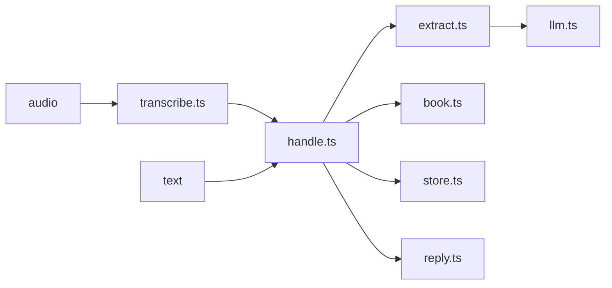

# Architecture

One Node 26 process runs TypeScript directly (type stripping, no build step).
`server/` holds the logic. `web/` is a Cloudflare Worker that serves the chat
page and forwards `/api/*` to the server. See [the web channel](web.md).

The model reads. The code decides. The language model turns a message into
items; every amount, name rule and credit balance comes from the code.

## Modules in `server/src`

| File            | Owns                                                                                                                                             |
| --------------- | ------------------------------------------------------------------------------------------------------------------------------------------------ |
| `handle.ts`     | The one entry every channel calls: a text or audio message in, rows recorded and a short reply out. Runs messages one at a time, in order.       |
| `extract.ts`    | One or several messages to items, validated with zod. The few-shot examples in `prompt.ts` go in once per call.                                  |
| `llm.ts`        | The OpenAI SDK pointed at Groq (`openai/gpt-oss-120b`), with Gemini as fallback on 429, 5xx or no connection. JSON-schema output, temperature 0. |
| `transcribe.ts` | Audio bytes and a media type to text: Groq `whisper-large-v3`, Spanish, with a prompt of shop vocabulary. The only owner of transcription.       |
| `book.ts`       | The rules as pure functions: amounts in cents, the credit ledger, cash flow, the payment estimate. See [rules](rules.md).                        |
| `store.ts`      | SQLite (`node:sqlite`): rows, ids of processed messages, and the pending question.                                                               |
| `reply.ts`      | Every sentence sent to Doña Rosa, in plain Spanish.                                                                                              |
| `app.ts`        | The Hono routes. See [the API](api.md).                                                                                                          |
| `whatsapp.ts`   | The WhatsApp channel: a linked number's one-to-one chats in, `handle` replies out. See [WhatsApp](whatsapp.md).                                  |
| `server.ts`     | Wires the real model, Whisper and SQLite to the app and listens on `PORT`. Starts the WhatsApp channel when `WHATSAPP=on`.                       |
| `csv.ts`        | The input and output CSV formats.                                                                                                                |
| `score.ts`      | Compares rows with an answer key for the eval.                                                                                                   |

`server/bin/batch.ts` and `server/bin/eval.ts` call the same `handle.ts` as the
server.

## One message

1. `handle` returns the stored reply if the id was seen.
2. An audio message is transcribed first. A note that cannot be heard returns an
   apology and records nothing.
3. A short "borra lo último" (or "elimina", "anula", "quita", "deshaz" the last
   one) deletes the rows of the latest message that added any, with no model
   call, and the reply names them.
4. `extract` receives the text, the pending question and the open credits.
5. `book` applies the rules to each item and `store` records the rows in one
   SQLite transaction. A message that answers the pending question fills that
   row.
6. `reply` writes the answer: what was noted, the next question, or the payment
   estimate. A message with nothing to note asks the pending question again.

## Reading in batches

`extract.lote(textos)` returns an extractor that reads up to 30 messages per
call, so the few-shot examples are sent once for the whole week. It serves
`handle` one message at a time. Only the first message of a call sees the
pending question and credits as context; later messages in the same call are
read in sequence by the model. When a call answers only some of the messages,
`extract` keeps those and asks again for the missing ones, up to three calls.
The new call sends the whole list again, with the same context and numbers, and
names the messages to answer, so a follow-up is read next to the question it
answers.

## Tests

`server/test` drives `handle`, the HTTP app and the WhatsApp message handler
(with recorded Baileys messages) with a stand-in extractor and temporary SQLite
files. `web/test` drives the Worker's fetch handler with fake bindings.
`ejemplos.test.ts` replays the extractions that `bun run eval` recorded from the
real model for the 30 examples and requires the exact answer key.
